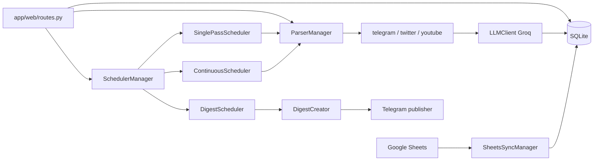

# AGENTS.md — NewsDigestApp Lite

Руководство для агентов, работающих с репозиторием. Подробная настройка API и `.env` — в [README.md](README.md).

## Назначение

Портативное **Windows**-приложение на Python: сбор новостей (Twitter/X, Telegram, YouTube) по списку из Google Sheets, фильтрация через **Groq LLM**, хранение в **SQLite**, публикация в Telegram, управление через **веб-админку** (Quart) и **системный трей**.

## Стек (кратко)

| Слой | Технологии |
|------|------------|
| ASGI | Quart, Hypercorn, `quart_cors` |
| Планировщики | APScheduler (`AsyncIOScheduler`), asyncio-задачи в `SchedulerManager` |
| БД | SQLAlchemy 2.x, SQLite (`data/news.db`) |
| Парсинг | Telethon, Tweepy, Google API Client |
| ML | Groq OpenAI-совместимый API, `instructor`, Pydantic-модели ответов |
| Конфиг | `python-dotenv`, `app/configs/config.py`, персистентность через `EnvManager` → `.env` |
| Зависимости | **`pyproject.toml` + `uv.lock`**; `requirements.txt` — `uv export` для portable `python_dist` |

## Точки входа

| Файл | Роль |
|------|------|
| `tray.py` | Полный запуск: дочерний Hypercorn + трей (`run.bat` → портативный `python_dist/python.exe`) |
| `main.py` | Только Quart-сервер; `create_app()`, `@app.before_serving` / `after_serving` |
| `app/scripts/server_script.py`, `tray_script.py` | Вспомогательные сценарии запуска из оркестратора |

Локальная разработка (uv):

```powershell
cd C:\Users\user\Documents\GitHub\NewsDigestApp_Lite
install_dev.bat
uv run main.py
# или uv run tray.py / run_dev.bat
```

Новые зависимости: `uv add <package>`, затем `export_requirements.bat` перед portable-сборкой.
Портативный релиз: `install.bat` → `run.bat` (без изменений).

Админка: `http://127.0.0.1:5000` (порт из `WEB_PORT`).

## Архитектура потока данных



### Куда смотреть при изменениях

| Задача | Файлы |
|--------|--------|
| Новый источник / правки сбора | `app/parsers/base_parser.py`, `*_parser.py`, `parser_manager.py`, лист в Google Sheets + `GoogleSheetsConfig.sheets_mapping` |
| LLM-промпты и схемы ответов | `app/configs/llm_prompts.py`, `app/ml/llm_client.py` |
| Расписания и режим `BYPASSING_METHOD` | `app/scheduler/scheduler_manager.py`, `continuous_scheduler.py`, `single_pass_scheduler.py`, `digest_scheduler.py` |
| Модель данных | `app/database/models.py`, `app/database/db_utils.py` |
| API и UI | `app/web/routes.py`, `app/web/templates/`, `app/web/static/` |
| Сохранение настроек из UI | `app/configs/env_manager.py` + `config.update_config()` |

Глобальный синглтон конфигурации: `from app.configs import config` (экземпляр `Config`).

`main.py` после старта вызывает `set_managers()` в `routes.py` — веб-маршруты держат ссылки на те же `ParserManager` / `SchedulerManager`, что и планировщики.

## Конвенции кода

- Docstring и пользовательские сообщения в логах часто **на русском**; идентификаторы и имена модулей — **латиница**, snake_case.
- Парсеры наследуют `BaseParser`; закрытие ресурсов — **async** (`await parser.close()`).
- Веб-хендлеры Quart — **async def**; блокирующий I/O в event loop не добавлять без `asyncio.to_thread` / executor.
- Новые настройки: поле в dataclass (`AppConfig` / `APIConfig` / `SchedulerConfig`), переменная в `.env`, при необходимости — поле в UI settings и путь через `EnvManager.save_and_update_config`.
- Минимальный дифф: не трогать несвязанные парсеры, шаблоны и `.env` без запроса.

## Секреты и git

**Не коммитить:** `.env`, `data/credentials/google_credentials.json`, `data/news.db`, сессии Telegram, содержимое `data/` (см. `.gitignore`).

При коммите по явной просьбе пользователя — предупредить, если в индексе оказались секреты.

## Окружение агента

- Целевая ОС разработки и запуска — **Windows**; в PowerShell цепочки команд через `;`, не `&&`.
- Проект ориентирован на **портативный** Python в `python_dist/`; для CI/агента достаточно системного Python 3.10+ и venv.
- Реальные API-ключи агенту обычно недоступны: smoke-тест ограничить импортами, линтером и юнит-логикой без сети; интеграции — по согласованию с пользователем.

## Проверка после правок Python

После изменения `.py` (настройки в `pyproject.toml` → `[tool.ruff]`, без `python_dist/`):

```powershell
uv run ruff check .
uv run ruff format .
```

Должно завершаться с `All checks passed!`. Тестовой папки в репо по умолчанию нет (`tests/` в `.gitignore`).

Проверка типов: при наличии `ty` или `mypy` — прогнать по затронутым модулям; иначе — вручную соблюдать аннотации в стиле соседнего кода (`ParserManager | None`, async-методы).

**Готово**, когда: `ruff check` без ошибок по изменённым файлам, импорт затронутых модулей выполняется (`python -c "from app...."`).

## Режимы работы (`BYPASSING_METHOD`)

| Значение | Поведение |
|----------|-----------|
| `NONE` | Только ручной/веб-запуск и дайджесты по расписанию |

После single-pass: `ONCE_DIGEST_COUNT` daily-дайджестов подряд; дедуп — `app/ml/embedding_service.py` + `add_news_with_embedding` в `db_utils.py`.
| `LOOP` | Непрерывный обход каналов (`ContinuousScheduler`) |
| `ONCE` | Единичный проход (`SinglePassScheduler`) |

Режим читается при старте в `initialize_managers()` (`main.py`).

## Частые задачи агента

### Добавить или изменить LLM-этап в пайплайне новости

1. Промпт в `llm_prompts.py`.
2. Pydantic-модель и вызов в `llm_client.py` (учитывать `BLOCKED_MODELS`, семафор и retry на rate limit).
3. Вызов из `BaseParser` или `DigestCreator` — не дублировать HTTP-клиент.
4. Прогнать `ruff check app/ml/ app/parsers/base_parser.py`.

### Новый HTTP/API endpoint админки

1. Async-роут в `app/web/routes.py`; проверка на `None` у глобальных менеджеров (как в существующих endpoint).
2. При изменении контракта — `static/js/*.js` и шаблон.
3. Ручная проверка: `python main.py`, запрос к endpoint (без продакшен-ключей — mock или только валидация 4xx).

### Изменить схему БД

1. `app/database/models.py`.
2. Логика миграции в `db_utils.py` (Alembic в репо не подключён) — для Lite часто достаточно пересоздания `data/news.db` в dev; в ответе пользователю указать риск потери данных.

## Документация библиотек

При вопросах по API Quart, Telethon, Groq, instructor, APScheduler — использовать **Context7 MCP** (`resolve-library-id` → `query-docs`), не опираться только на память модели.

## Вне скоупа Lite (из README)

Reddit-парсер в зависимостях есть, в `ParserManager` не подключён. Локальные ML-модели (`MODEL_TYPE` ≠ `LLM_API`) в Lite не целевой путь — ориентир на Groq API.

## Контакты и лицензия

GPL-3.0. Вопросы по продукту — см. README (email, GitHub Issues).
